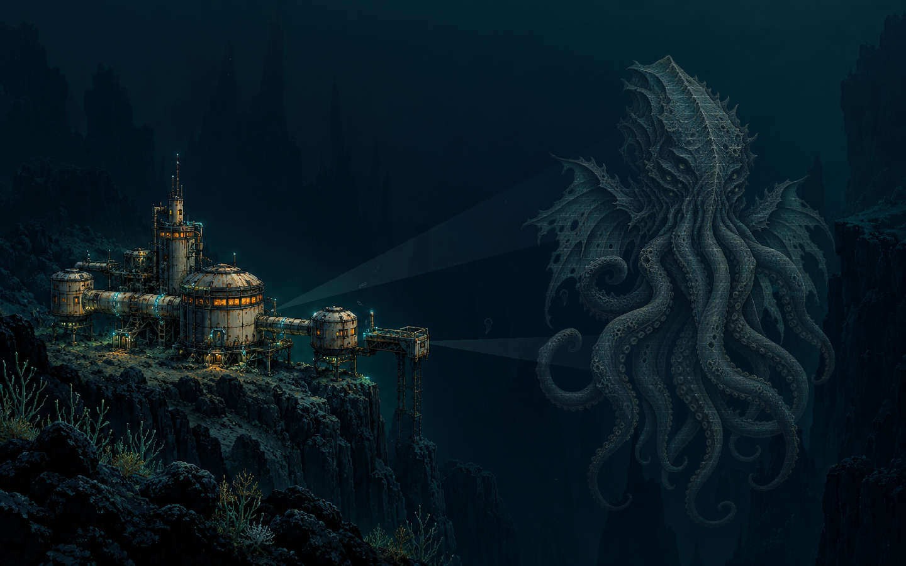
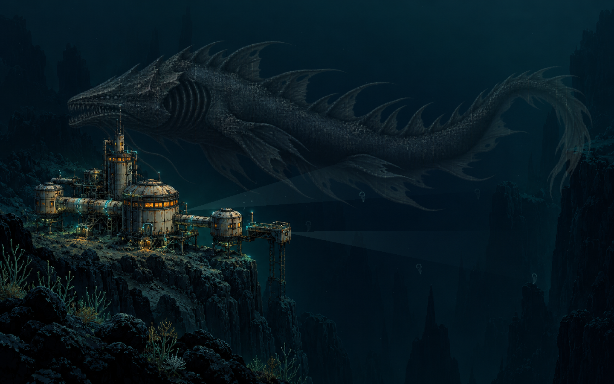

# Станция «Бездна» — Abyss Station

[English overview](../README.md) · [Общая инструкция на русском](../README.ru.md) · [MIT](../LICENSE)

Самостоятельная заставка macOS **`AbyssStation.saver`**: маленькая исследовательская станция на краю океанского провала. Тёплые окна и узкие прожекторы подчёркивают масштаб почти чёрной воды. В глубине постепенно проявляется древнее щупальчатое существо или проходит огромный левиафан.

Настроение вдохновлено талассофобией, космическим ужасом Лавкрафта и ощущением глубины из **Subnautica**. Архитектура и существа созданы для этого проекта; игровых изображений и моделей в нём нет.


| Древний обитатель глубин | Левиафан |
| --- | --- |
|  |  |

## Что движется

- Огромные существа медленно плывут, покачиваются и шевелят щупальцами. Их изображения деформируются кодом; силуэты постепенно выходят из темноты и растворяются в ней.
- Прожекторы исследуют толщу воды, окна независимо и плавно меняют яркость.
- Над станцией поднимаются пузырьки, в воде движется морской снег и редкие биолюминесцентные организмы.

Первое появление щупальчатого существа начинается примерно через **5 секунд**. Проявление занимает около **10 секунд**, затухание — **13 секунд**. Первый эпизод длится 72–90 секунд; последующие появления — 65–95 секунд с паузами 35–75 секунд. Направление, длительность и вариации выбираются по случайному расписанию. Окна сохраняют яркость на 24–100 секунд и меняют её за 5–9 секунд; начало их циклов разнесено.

Фон и два существа — локальные ресурсы `Resources/abyss-station.png`, `abyss-elder.png` и `abyss-leviathan.png`, созданные генерацией изображений. Происхождение и запросы описаны в [Resources/ARTWORK.md](Resources/ARTWORK.md). Оба приложения включают эти ресурсы: во время работы сеть, API-ключи и внешние сервисы не нужны.

## Сначала предпросмотр в Xcode

1. Откройте [AbyssStation.xcodeproj](AbyssStation.xcodeproj).
2. В верхней панели выберите **AbyssStationPreview → My Mac**.
3. Нажмите **Run (`⌘R`)**. Откроется отдельное окно с тем же кодом рисования и анимации, что у модуля заставки.
4. Меняйте размер окна. **`⌘1`** включает маленький предпросмотр 420×263, **`⌘2`** возвращает обычное окно, **`⌃⌘F`** включает или выключает полный экран.

Схема **AbyssStation** собирает `.saver`; для запуска окна используйте именно **AbyssStationPreview**.

## Сборка, проверка и установка

Все команды выполняются из корня репозитория:

```sh
./scripts/build.sh abyss preview
open build/abyss/Build/Products/Debug/AbyssStationPreview.app

./scripts/build.sh abyss
./scripts/check.sh abyss
./scripts/install.sh abyss
```

Релизный модуль: `build/abyss/Build/Products/Release/AbyssStation.saver`. Перед установкой закройте Системные настройки; после копирования откройте раздел **Заставка** и выберите **Станция «Бездна» / AbyssStation**. Подробности выбора Xcode, установки и карантина — в [общей инструкции](../README.ru.md).

Предпросмотр и модуль используют общий `ScreenSaverView`, модель и рисование из `Shared/`. Логика работает с ограниченным числом состояний; после сна она продолжает сцену без проигрывания пропущенных часов.

## Проверки и инструменты

`./scripts/check.sh abyss` проверяет расписания существ, плавность появления и освещения, 30 минут симуляции, восстановление после пауз, некорректные отметки времени и одинаковую работу модели при 30 и 60 кадрах в секунду. Если Release-модуль собран, дополнительно проверяется его загрузка и главный класс `ScreenSaverView`.

Для воспроизводимых снимков используется настоящий view с фиксированным начальным состоянием. Из корня репозитория:

```sh
mkdir -p build/abyss-tools
DEVELOPER_DIR=/Applications/Xcode.app/Contents/Developer xcrun swiftc \
  -O -parse-as-library -framework AppKit -framework ScreenSaver \
  -module-cache-path build/abyss-tools/module-cache \
  Abyss/Shared/*.swift Abyss/Tools/RenderAbyssSnapshots.swift \
  -o build/abyss-tools/render-snapshots
build/abyss-tools/render-snapshots
```

Снимки сохраняются в `build/abyss-snapshots/`: 420×263, 1440×900, 1920×1080, 2560×1080, 900×1440, 3024×1890 и 3840×2160, а также отдельные кадры начальной сцены и левиафана. Сцена сохраняет пропорции при разных размерах окна.

Пятнадцать секунд анимации при 12 кадрах в секунду можно отрисовать в PNG-кадры:

```sh
DEVELOPER_DIR=/Applications/Xcode.app/Contents/Developer xcrun swiftc \
  -O -parse-as-library -framework AppKit -framework ScreenSaver \
  -module-cache-path build/abyss-tools/module-cache \
  Abyss/Shared/*.swift Abyss/Tools/RenderAbyssAnimation.swift \
  -o build/abyss-tools/render-animation
build/abyss-tools/render-animation
```

Кадры появятся в `build/abyss-animation-frames/`. Для их сборки в GIF можно отдельно использовать FFmpeg; для самой заставки он не требуется.

Замер рисования общего view в памяти:

```sh
DEVELOPER_DIR=/Applications/Xcode.app/Contents/Developer xcrun swiftc \
  -O -parse-as-library -framework AppKit -framework ScreenSaver \
  -module-cache-path build/abyss-tools/module-cache \
  Abyss/Shared/*.swift Abyss/Tools/BenchmarkAbyss.swift \
  -o build/abyss-tools/benchmark
build/abyss-tools/benchmark
```

В проверенной сборке после прогрева (45 кадров, буфер 1×):

| Размер | Медиана кадра | 95-й процентиль |
| --- | --- | --- |
| 1440×900 | 10,626 мс | 11,120 мс |
| 3840×2160 | 19,833 мс | 20,645 мс |
| 420×263 | 2,200 мс | 2,440 мс |

Это измерение на одном Mac, а не гарантия частоты кадров на любом устройстве. Оно исключает первоначальное декодирование ресурсов, запись PNG и работу системного окна. Внеэкранное рисование и проверки модели не заменяют проверку установленного модуля в ScreenSaverEngine: оцените полный экран, маленький предпросмотр и выход из сна на своём Mac.

## Изменение сцены и публикация

- `Shared/AbyssSceneModel.swift` — расписания появлений, яркость окон и восстановление после пауз.
- `Shared/AbyssArtworkView.swift` — композиция, анимация существ, прожекторы и частицы.
- `Shared/AbyssStationSaverView.swift` — жизненный цикл модуля.
- `Resources/` — обязательные исходные изображения и история их создания.

Сохраняйте ресурсы в обеих целях Xcode. Личные настройки Xcode, сборки и результаты инструментов исключены корневым [.gitignore](../.gitignore). Проект распространяется по [MIT](../LICENSE); это независимая работа без связи с авторами Subnautica.
