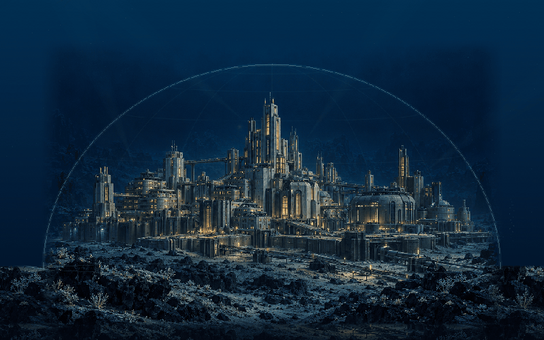
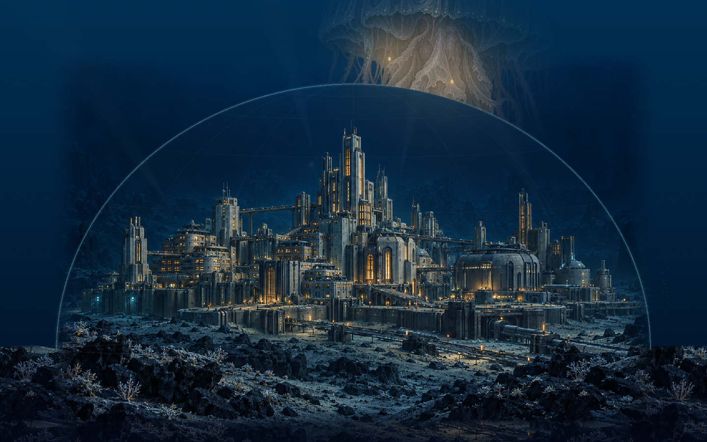
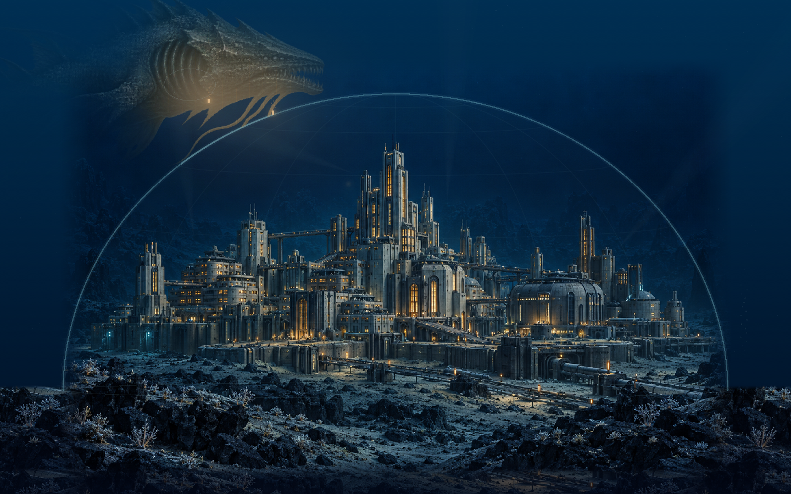

# Форпост «Надир» — Hadal Outpost

[English overview](../README.md) · [Общая инструкция на русском](../README.ru.md) · [MIT](../LICENSE)

Самостоятельная заставка macOS **`HadalOutpost.saver`**, версия **0.2.0**. Крупный подводный микрогород стоит на настоящем морском дне: башни, переходы и тяжёлые основания окружены скалами и осадком. Полупрозрачное силовое поле обозначает защищённый от давления объём над городом. Монстры приближаются только из верхней толщи воды.

Прожекторы выхватывают фрагменты огромных существ. Световые шашки медленно разгораются, а защитный заряд заставляет существо свернуть и уйти обратно вверх, в темноту. Мрачное окружение сохраняет читаемый рельеф и масштаб города.

Предыдущая [«Станция „Бездна“»](../Abyss/README.md) остаётся отдельным проектом: её исходники, ресурсы и имя модуля сохраняются.



В примере — 50 секунд реального хода сцены: шашки, заряд, реакция и исчезновение существа.

| Свет обнаруживает существо | Защитный импульс |
| --- | --- |
|  |  |

## Пять видов

| Вид | Силуэт | Предпросмотр |
| --- | --- | --- |
| `maw` | Крупный бронированный хищник с длинной зубастой пастью | `⌘3` |
| `ribbon` | Длинный глубоководный угорь с волнообразным телом | `⌘4` |
| `medusa` | Гигантская медуза с колоколом и свисающими нитями | `⌘5` |
| `carapace` | Массивное ракообразное с тяжёлым панцирем и конечностями | `⌘6` |
| `elder` | Древнее щупальчатое существо со складчатой мантией | `⌘7` |

В естественном режиме виды сменяют друг друга по расписанию. Все пять видов приходят сверху и остаются в открытой воде над защитным полем и морским дном. Появление проходит через последовательные стадии: приближение, подсветка, реакция на защиту и отход. Между встречами город продолжает освещать воду, меняется свет окон и движется взвесь.

Существа вдохновлены атмосферой **Subnautica**, **Barotrauma** и космического ужаса. Архитектура города — самостоятельная монументальная научная фантастика. Здесь используются собственные иллюстрации; игровые спрайты, модели и скриншоты не включены. Визуальные ориентиры и запросы генерации описаны в [Resources/ARTWORK.md](Resources/ARTWORK.md).

## Предпросмотр в Xcode

1. Откройте [HadalOutpost.xcodeproj](HadalOutpost.xcodeproj).
2. Выберите **HadalOutpostPreview → My Mac**.
3. Нажмите **Run (`⌘R`)**. Окно использует тот же код рисования и анимации, что модуль `.saver`.

Управление:

- `⌘1` — маленький предпросмотр 420×263;
- `⌘2` — обычное окно;
- `⌃⌘F` — полный экран;
- `⌘3`…`⌘7` — начать встречу с выбранным видом;
- `⌘0` — вернуть естественную смену существ.

Размер окна также можно менять мышью. Выбор вида относится только к приложению предпросмотра; установленная заставка работает автоматически. Для запуска окна нужна схема **HadalOutpostPreview**: схема **HadalOutpost** собирает модуль заставки.

## Сборка, проверка и установка

Команды выполняются из корня репозитория:

```sh
./scripts/build.sh hadal preview
open build/hadal/Build/Products/Debug/HadalOutpostPreview.app

./scripts/build.sh hadal
./scripts/check.sh hadal
./scripts/install.sh hadal
```

Готовый модуль: `build/hadal/Build/Products/Release/HadalOutpost.saver`. Перед установкой закройте Системные настройки, затем откройте раздел **Заставка** и выберите **Форпост «Надир»**. Выбор Xcode, установка в свою учётную запись и работа с карантином описаны в [общей инструкции](../README.ru.md).

## Проверки и инструменты

`./scripts/check.sh hadal` запускает проверки модели: длительную симуляцию всех пяти видов, верхние маршруты над полем и дном, отсутствие повторов подряд и правильную последовательность шашек, заряда, попадания и отхода. Также проверяются независимое освещение, плавность, ограниченное число объектов, совпадение при 30/60 fps и восстановление после сна. Если Release-модуль уже собран, команда дополнительно проверяет его загрузку и главный класс `ScreenSaverView`.

Воспроизводимые снимки общего view можно получить без окна:

```sh
mkdir -p build/hadal-tools
DEVELOPER_DIR=/Applications/Xcode.app/Contents/Developer xcrun swiftc \
  -O -parse-as-library -framework AppKit -framework ScreenSaver \
  -module-cache-path build/hadal-tools/module-cache \
  Hadal/Shared/*.swift Hadal/Tools/RenderHadalSnapshots.swift \
  -o build/hadal-tools/render-snapshots
build/hadal-tools/render-snapshots
```

Для анимационных кадров и замера рисования рядом находятся `Tools/RenderHadalAnimation.swift` и `Tools/BenchmarkHadal.swift`; их можно собрать той же командой, заменив имя исходника и выходного файла. Результаты хранятся в игнорируемой папке `build/`.

Инструмент снимков создаёт 17 кадров: семь размеров от 420×263 до 3840×2160, все пять видов, четыре стадии встречи и начальную сцену. Инструмент анимации создаёт 600 PNG за 50 секунд при 12 fps. Графика и мягкая маска света используют отдельные буферы; фон и конусы света кешируются.

`BenchmarkHadal.swift` измеряет 45 кадров после прогрева при масштабе буфера 1×. Замер исключает первичное декодирование PNG, запись файлов и работу системного окна; результаты старой маленькой станции не описывают новую композицию с городом и куполом.

Внеэкранные снимки, проверки модели и загрузка bundle не заменяют проверку установленной заставки в системном ScreenSaverEngine. Полный экран, маленький системный предпросмотр и восстановление после сна следует оценить на своём Mac.

## Ресурсы и изменение сцены

- `Shared/HadalSceneModel.swift` — верхние маршруты встреч, параметры защищённого объёма, световые шашки, защитные заряды и реакция существ.
- `Shared/HadalArtworkView.swift` — микрогород на дне, силовое поле, маски освещения, деформация существ и частицы.
- `Shared/HadalOutpostSaverView.swift` — жизненный цикл заставки.
- `Preview/PreviewApp.swift` — окно, меню и выбор вида для просмотра.
- `Resources/` — обязательные PNG и сведения об их происхождении.

Оба приложения включают шесть ресурсов: `hadal-city-seabed.png` с городом и ландшафтом, а также `hadal-maw.png`, `hadal-ribbon.png`, `hadal-medusa.png`, `hadal-carapace.png` и `hadal-elder.png`. Прежняя иллюстрация `hadal-station.png` сохранена в исходниках, но не используется и не включается в новые сборки. Иллюстрации созданы генерацией изображений; часть существ использует сохранённые оригинальные иллюстрации из «Бездны». Во время работы не нужны сеть, API-ключи или загрузка изображений.

Проект распространяется по [MIT](../LICENSE). Это независимая работа, не связанная с авторами Subnautica и Barotrauma. Исходные изображения и общие схемы Xcode нужны в Git; сборки, локальное состояние Xcode и ключи подписи исключены корневым [.gitignore](../.gitignore).
