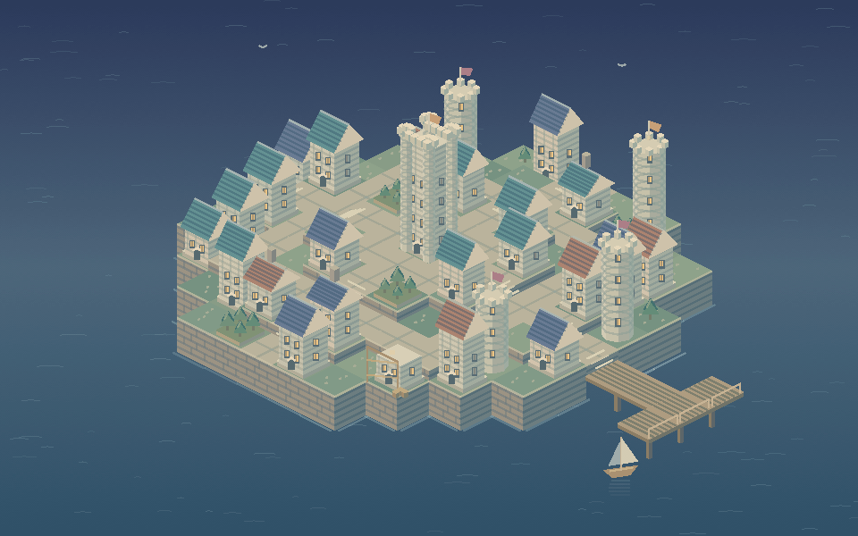

# Самостроящийся мир — Living Island

Настоящая заставка macOS **`LivingIsland.saver`**: маленький остров постепенно превращается в каменный город-замок. На террасах стоят дома с черепичными крышами, башни, сады и мастерские; дороги и лестницы соединяют кварталы, деревянный мост ведёт к гавани.



Все изображения рисуются кодом. У завершённых зданий кешируется геометрия, а на действующей стройке стены поднимаются слоями, затем появляется крыша; строительные леса и переносимые блоки показывают работу. Некоторые здания аккуратно разбираются сверху вниз и позднее заменяются. Океан, флаги, птицы и лодка продолжают двигаться между проектами. Каждый запуск получает другое сочетание архитектуры и цветов крыш.

## Предпросмотр

1. Откройте [LivingIsland.xcodeproj](LivingIsland.xcodeproj).
2. Выберите **LivingIslandPreview → My Mac** и нажмите **Run (`⌘R`)**.
3. `⌘1` — маленькое окно 420×263, `⌘2` — обычное, `⌃⌘F` — полный экран.
4. `⌘3` создаёт новый остров. Изменение размера сохраняет текущую стройку.

Предпросмотр и установленная заставка используют один `ScreenSaverView` и общую сцену.

## Собрать и установить

Из корня репозитория:

```sh
./scripts/build.sh island preview
./scripts/build.sh island
./scripts/check.sh island
./scripts/install.sh island
```

Модуль находится в `build/island/Build/Products/Release/LivingIsland.saver`. Общая [русская инструкция](../README.ru.md) описывает выбор Xcode, установку в `~/Library/Screen Savers/` и карантин скачанных модулей. Минимальная версия в настройках сборки — macOS 13.0; версия проекта — 0.1.0. Готовый релиз собирается для Apple Silicon и Intel.

## Модель и проверки

Основания острова, пути и пирс остаются постоянными. Строительные участки находятся только на земле рядом со связной сетью дорог; лестницы преодолевают разницу высот. Главный замок и маяк сохраняются, а на остальных участках одновременно меняется только одно здание. Число участков ограничено, старые события не накапливаются.

`Tools/TestIslandScene.swift` проверяет 64 острова, связность улиц и гавани, опору и границы зданий, строительство и разборку, 30 минут симуляции, восстановление после сна и совпадение модели при 30/60 fps.

Для воспроизводимых снимков из общего view:

```sh
mkdir -p build/island-tools
DEVELOPER_DIR=/Applications/Xcode.app/Contents/Developer xcrun swiftc \
  -O -parse-as-library -framework AppKit -framework ScreenSaver \
  -module-cache-path build/island-tools/module-cache \
  Island/Shared/*.swift Island/Tools/RenderIslandSnapshots.swift \
  -o build/island-tools/render-snapshots
build/island-tools/render-snapshots
```

Инструмент создаёт семь размеров от 420×263 до 3840×2160 и два дополнительных состояния в `build/island-snapshots/`. `RenderIslandAnimation.swift` создаёт 180 PNG за 15 секунд при 12 fps, а `BenchmarkIsland.swift` измеряет прогретое рисование без записи файлов. Их можно собрать той же командой, заменив имя инструмента и выходного файла.

За 30 минут проверенной симуляции завершились 42 стройки и 29 разборок; заняты 44 из 45 участков. В оптимизированном внеэкранном замере 45 кадров после прогрева при масштабе 1× получены:

| Размер | Медиана кадра | 95-й процентиль |
| --- | --- | --- |
| 1440×900 | 1,328 мс | 1,530 мс |
| 3840×2160 | 13,654 мс | 14,157 мс |
| 420×263 | 0,381 мс | 0,467 мс |

Это измерение на одном Mac, без первоначальной подготовки кешей, записи PNG и работы системного окна; оно не гарантирует такую же производительность на любом устройстве.

Внеэкранные проверки и загрузка bundle не заменяют проверку установленной заставки в ScreenSaverEngine. Размеры окна, системный предпросмотр и выход из сна следует оценить на своём Mac.

## Изменение сцены

- `Shared/IslandSceneModel.swift` — форма острова, участки, архитектура и расписание строительных работ.
- `Shared/IslandArtworkView.swift` — изометрическая геометрия, кладка, крыши, вода и детали.
- `Shared/LivingIslandSaverView.swift` — жизненный цикл модуля.
- `Preview/PreviewApp.swift` — окно и команда нового острова.

Сторонних ассетов, генерации изображений, сетевых запросов и дополнительных библиотек нет. Исходники и общие схемы публикуются по [MIT](../LICENSE); результаты сборки и личные настройки Xcode исключены корневым `.gitignore`.
