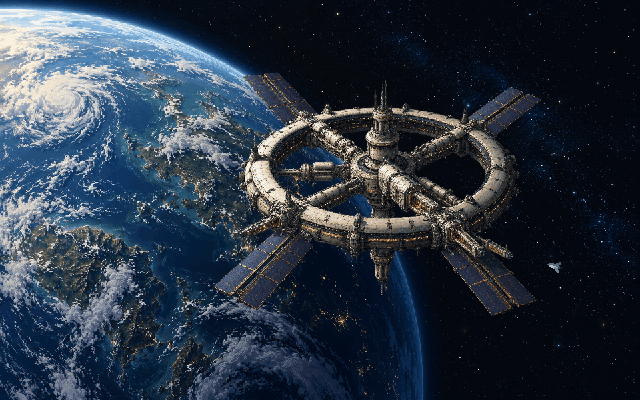

# Орбитальная станция

Самостоятельная заставка macOS **`OrbitalStation.saver`**: большой обитаемый орбитальный комплекс на фоне планеты с облаками, тонкой атмосферой, границей дня и ночи и огнями городов. Кольцевая станция медленно меняет ориентацию; на кольце движутся огни, небольшие корабли прилетают к трём портам, остаются у станции и затем отправляются дальше.

[English overview](../README.md) · [Общая инструкция](../README.ru.md) · [MIT](../LICENSE)



## Предпросмотр

1. Откройте [OrbitalStation.xcodeproj](OrbitalStation.xcodeproj).
2. В верхней панели выберите **OrbitalStationPreview → My Mac**.
3. Нажмите **Run (`⌘R`)**.

`⌘1` — маленький предпросмотр 420×263, `⌘2` — обычное окно, `⌃⌘F` — полный экран. Окно можно растягивать мышью. При переходе между размерами состояние сцены сохраняется.

Схема **OrbitalStation** собирает модуль `.saver`; для запуска отдельного окна нужна **OrbitalStationPreview**. Предпросмотр и заставка используют один `ScreenSaverView`, модель и код рисования.

## Жизнь станции

У трёх портов независимые расписания. Приближение длится 18–26 секунд, остановка у порта — 8–15 секунд, отлёт — 18–25 секунд. Затем следует пауза 20–55 секунд. Один корабль уже приближается при запуске; остальные появляются с задержками. Одновременно существуют не более трёх кораблей.

Корабли тормозят перед стыковкой, гасят тягу, разворачиваются во время обслуживания и включают двигатели при отходе. Их позиции и углы непрерывны между фазами. Порты и корабли используют систему координат станции, поэтому медленное изменение её ориентации не нарушает стыковку. Огни и освещение меняются плавно, без резких вспышек.

Ресурсы планеты и станции находятся в модуле; сеть, внешние сервисы и API-ключи во время работы не нужны. Исходные изображения созданы встроенным `imagegen`; [происхождение и точные запросы](Resources/ARTWORK.md). Текстуры и игровые ассеты из других произведений не использованы.

## Сборка и установка

Из корня репозитория:

```sh
./scripts/build.sh orbit preview
open build/orbit/Build/Products/Debug/OrbitalStationPreview.app

./scripts/build.sh orbit
./scripts/check.sh orbit
```

Релизный модуль: `build/orbit/Build/Products/Release/OrbitalStation.saver`. Он содержит архитектуры `arm64` и `x86_64`.

После просмотра закройте Системные настройки и установите:

```sh
./scripts/install.sh orbit
```

Выберите **«Орбитальная станция»** в настройках заставки macOS. Установка выполняется в вашей учётной записи, без `sudo`. Выбор Xcode и ограничения локальной подписи описаны в [общей инструкции](../README.ru.md).

## Проверки и рендер

В воспроизводимой 30-минутной симуляции прошли 59 стыковок: все три порта и все фазы, не более трёх кораблей одновременно. Проверены непрерывность положения, угла и тяги, одинаковая работа при 30/60 fps, восстановление после сна и большие скачки времени. Загрузка Release bundle проверяет главный класс `ScreenSaverView`.

Снимки получают тот же view на семи размерах: 420×263, 1440×900, 1920×1080, 2560×1080, 900×1440, 3024×1890 и 3840×2160; отдельно сохраняются кадры приближения, стоянки и отлёта.

```sh
mkdir -p build/orbit-tools
DEVELOPER_DIR=/Applications/Xcode.app/Contents/Developer xcrun swiftc \
  -O -parse-as-library -framework AppKit -framework ScreenSaver \
  -module-cache-path build/orbit-tools/module-cache \
  Orbit/Shared/*.swift Orbit/Tools/RenderOrbitSnapshots.swift \
  -o build/orbit-tools/render-snapshots
build/orbit-tools/render-snapshots
```

Результат — `build/orbit-snapshots/`. `Tools/RenderOrbitAnimation.swift` собирается той же командой и создаёт 432 PNG за 36 секунд при 12 fps в `build/orbit-animation-frames/`. Для GIF можно отдельно использовать FFmpeg; заставке он не требуется. `Tools/BenchmarkOrbit.swift` измеряет 45 кадров после прогрева, исключая первую загрузку PNG и работу системного окна.

Замер оптимизированного рисования, 45 кадров после прогрева на одном Mac, буфер 1×:

| Размер | Медиана кадра | 95-й процентиль |
| --- | --- | --- |
| 1440×900 | 4,174 мс | 4,845 мс |
| 3840×2160 | 15,925 мс | 17,356 мс |
| 420×263 | 0,421 мс | 0,596 мс |

Замер исключает первоначальное декодирование PNG и работу системного окна; это не гарантия такой же скорости на любом устройстве. Внеэкранные проверки не заменяют проверку установленного модуля в ScreenSaverEngine. Полный экран, системный маленький предпросмотр и выход из сна следует оценить на своём Mac.

## Исходники

- `Shared/OrbitSceneModel.swift` — расписания трёх портов, траектории, время и восстановление после пауз.
- `Shared/OrbitArtworkView.swift` — композиция, свет, движение станции и кораблей, кеши рисования.
- `Shared/OrbitalStationSaverView.swift` — жизненный цикл `.saver`.
- `Preview/PreviewApp.swift` — окно и меню предпросмотра.
- `Resources/` — два обязательных исходных PNG и история их создания.

Проект распространяется по [MIT](../LICENSE). Результаты сборки, личное состояние Xcode и ключи подписи исключены корневым [.gitignore](../.gitignore).
